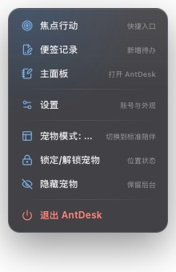
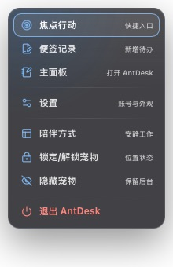
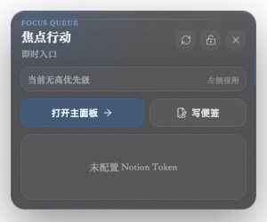
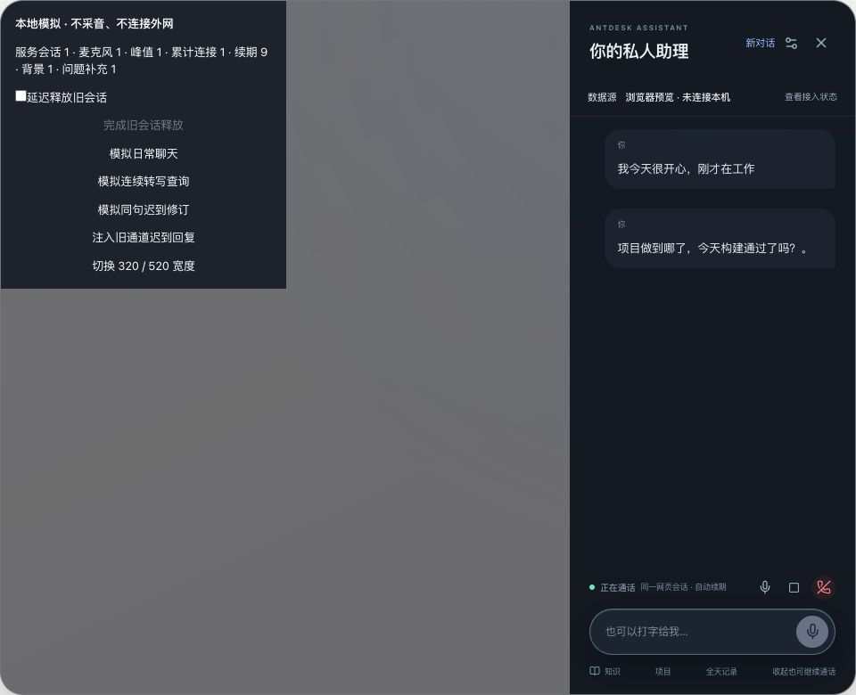

# AntDesk 2.19.5 交互审查与修复

2026-09-19。重点是退出路径、焦点归属和网页语音消息触发。原生验收使用隔离的 `com.antdesk.interaction-qa`，截图均来自本轮实际运行；语音页面使用真实 AssistantPanel/WebRTC 客户端及模拟信令，不采集麦克风、不向外部模型发送资料。

## 流程覆盖

| 步骤 | 实际检查 | 结果与边界 |
| --- | --- | --- |
| 1. 宠物 → 右键菜单 | 打开、Esc、方向键选择主面板、选择锁定、点击其他应用窗口 | 修复后能关闭；锁定状态在宠物上回读成功。点外关闭以截图确认，系统辅助树有短暂旧窗口缓存。 |
| 2. 宠物 → 焦点行动 | 左键打开、锁定任务、关闭、重新打开、内容高度 | 修复后关闭和解锁保持可用，内容完整，无水平滚动条。 |
| 3. 日程 → 日报 → 目标 | 空状态、日报编辑入口、未连接日程提示 | 页面可达；未使用真实 Notion 账户提交测试数据。日报换月图标补充了可访问名称。 |
| 4. 助理 → 设置 → 返回 | 原生窗口输入测试草稿，再打开和关闭设置 | 回到同一助理，草稿保留，焦点回到输入框；不会默认选中“新对话”。 |
| 5. 全局搜索 | 320px 窗口、Tab 循环、Esc | 搜索框和关闭按钮不溢出，焦点留在弹层内。 |
| 6. 助理 → 知识 → 返回 | 浏览器预览打开知识页，再按 Esc | 先返回对话；浏览器明确提示本地 Hermes 需要桌面端。未执行真实知识检索。 |
| 7. 语音 → 连续转写 → 续期 → 结束 | 真实页面配合模拟 WebRTC；日常聊天、查询修订、迟到修订 | 1 条启动背景、1 次问题资料补充；15 次续期仍为 1 次连接、1 个模拟麦克风；结束后两者均为 0。 |
| 8. 应用生命周期 | Command-Q、重新启动、重复启动、设置版本号 | 退出后无 QA 进程；重启恢复；设置显示 2.19.5。应用启动只提示更新，不再自动安装并重启。 |

## 已修复问题

- **P1 菜单无法退出**：`fab-menu` 和 `quick` 漏在 Tauri capabilities 之外，窗口操作和事件监听失败却被忽略。新增仅包含事件、隐藏与尺寸操作的 companion 权限；菜单关闭走原生命令，原生失焦也收起菜单；瞬时窗口关闭时隐藏而非销毁。
- **P1 语音多次重复确认**：网页 relay 的文本是用户消息，并非静默系统上下文。此前每段转写的修订都可能触发全量背景注入，普通知识关键词也会触发，并且旧检索结果可在新问题后到达。现在只有明确查询或“记住”请求触发补充，同一语句最多发送一次；新发言、打字、结束及重连均使旧结果失效。补充消息只携带本次资料，启动不再要求问候。未更换为 OpenAI API，也未加入未经网关支持的协议字段。
- **P1 快捷面板自锁**：旧“鼠标穿透”只是 CSS 禁用了整块面板的鼠标事件。改为“锁定任务”，只禁用任务完成操作，保留关闭、解锁、导航。
- **P1 快捷面板缩小**：恢复尺寸权限后复现动画尺寸与 viewport 高度上限相互反馈，面板缩到只剩标题。改用未应用动画变换的布局高度，取消依赖自身窗口高度的限制，尺寸不变时不再重复请求。
- **P2 延迟关闭误关重开的窗口**：移除 200ms 延迟隐藏；关闭即时完成，重新打开不会被旧定时器影响。
- **P2 任务保存失败却消失**：任务完成改为保存成功后移除；失败保留任务并显示可重试错误，同一任务提交中不能重复操作。这条为代码审查修复，未向真实 Notion 写入验收数据。
- **P2 弹层抢焦点及返回丢失**：主界面改为唯一的弹层状态，搜索、设置和助理不会同时打开。设置能返回助理，子页面 Esc 按层级返回；搜索补充焦点约束和可访问名称。
- **P2 更新打断通话**：移除启动后静默安装并重启。设置在通话期间禁用更新入口。
- **P2 菜单信息截断与键盘缺口**：陪伴方式采用简短名称和当前状态；加强辅助文字对比；支持方向键、Home/End、Enter、Esc/Tab，修复异步监听卸载泄漏。

## 本轮证据

菜单修复前（Esc 无效，陪伴模式被挤断）：

菜单修复后（当前状态完整、键盘焦点可见）：

点击外部应用后仅剩宠物；快捷面板内容完整：

设置返回后草稿保留；320px 搜索弹层：

语音计数截图（第 9 次续期时采集；后续第 15 次续期及结束后的计数由页面读回确认）：

其余实际页面：[设置与版本](qa/interaction-2.19.5/settings-final.png)、[日报编辑](qa/interaction-2.19.5/report-editor.png)、[目标空状态](qa/interaction-2.19.5/goals-empty.png)。

## 验证

- `yarn build`：通过。
- `cargo check --manifest-path src-tauri/Cargo.toml`：通过。
- `node --test tests/*.test.mjs`：61 项通过，包含新增的 7 项语音请求去重、旧结果取消、闲聊不注入与消息长度边界测试。
- `cargo test --manifest-path src-tauri/Cargo.toml --lib`：27 项通过、2 项原有真实服务测试按配置忽略。
- `tauri build --debug --no-bundle`：以隔离配置构建后进行上述原生交互验收。
- 四处版本声明统一为 2.19.5，提交后以 `v2.19.5` 标签和 release preflight 再次核对。

不能据此宣称网页语音模型一定不会偶尔问候：本轮验证的是客户端发送路径、数量和状态恢复，没有进行真实网页服务的连续语音实聊。Windows/Linux 交互和辅助技术完整性也未实机验证；键盘焦点及名称检查不是完整无障碍认证。真实 Notion 写入、Hermes 检索和长时间真实音频仍是验收边界。
